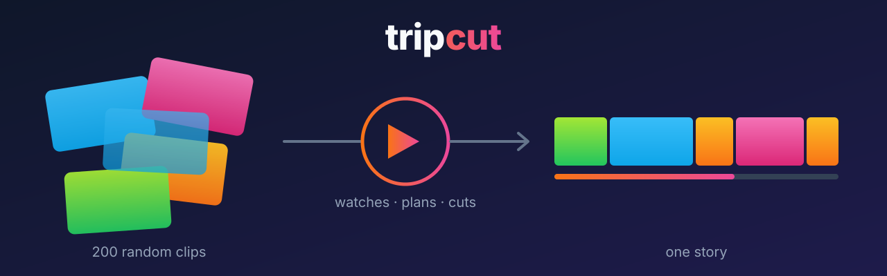
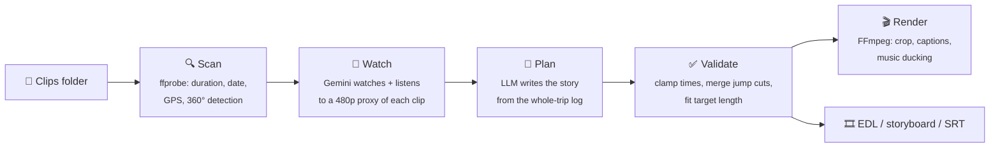
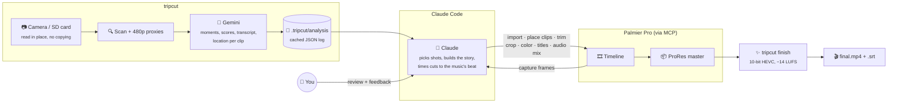

<p align="center">
  
</p>

<p align="center">
  <b>AI watches your travel footage and cuts it into a story.</b><br>
  Insta360 · GoPro · DJI · phone clips → one edited video, a storyboard, and a timeline for Resolve or Premiere.
</p>

<p align="center">
  <a href="https://github.com/divyankrahoria/tripcut/actions/workflows/ci.yml"></a>
  
  
  
</p>

---

You came back from a trip with 200 clips. Some are you talking to the camera, most are random. You don't know where to start, so they sit on a hard drive forever.

**tripcut** fixes that:

```bash
tripcut run ~/Videos/portugal-trip
```

It **watches and listens** to every clip, works out what's in each one (places, what you said, which moments are actually good), **plans a story** in recorded order, and **renders** a finished video with music that ducks under your voice, place-name captions, and clean cuts. It never cuts you off mid-sentence.

Unlike template-based auto-editors that only score how a shot *looks*, tripcut understands *what happens*: "open on the wide shot of the cliffs, then cut to you explaining where you are."

## ✨ What you get

| | |
|---|---|
| 🎬 **`portugal-trip-tripcut.mp4`** | A finished edit: 16:9, or 9:16 for Reels/Shorts |
| 📋 **`storyboard.md`** | Every shot, why it was picked, and where it sits |
| ✏️ **`plan.json`** | The edit as data. Reorder or delete shots, re-render in seconds |
| 🎞️ **`timeline.edl`** | Import into DaVinci Resolve / Premiere and finish it by hand |
| 💬 **`subtitles.srt`** | What you said, timed to the final cut |

## 🚀 Quickstart

**1. Install** (needs Python 3.10+ and [FFmpeg](https://ffmpeg.org/download.html))

```bash
brew install ffmpeg          # macOS (Ubuntu: sudo apt install ffmpeg, Windows: winget install ffmpeg)
pip install git+https://github.com/divyankrahoria/tripcut
```

**2. Get a free Gemini API key** at [aistudio.google.com/apikey](https://aistudio.google.com/apikey) (Google account only, takes about a minute)

```bash
export GEMINI_API_KEY=your-key-here
```

**3. Point it at a folder of clips from one trip**

```bash
tripcut run ~/Videos/portugal-trip --duration 90 --music ~/Music/summer.mp3
```

Making a Reel instead?

```bash
tripcut run ~/Videos/portugal-trip -a 9:16 -d 45 --subtitles --style "fast-paced, punchy, hook in the first 2 seconds"
```

> **No API key? No problem.** `tripcut run <folder> --provider local` does a quick rough cut on your machine using audio and timing heuristics. Nothing is uploaded. It's less smart, but handy for a first pass.

## 🧠 How it works



1. **Scan.** Finds every clip and reads when it was recorded (from metadata, or from Insta360/GoPro-style filenames like `VID_20260912_101530_…`). This gives the true chronology of your trip.
2. **Watch.** Each clip is shrunk to a small 480p proxy (fast upload, identical timing) and sent to Gemini, which returns a structured log: summary, likely location, transcript, and the best moments with timestamps and a 1–10 score. **Results are cached**, so re-planning and re-rendering cost nothing.
3. **Plan.** A second call reads the whole trip's log, like an editor reading their assistant's notes, and decides the story: cold open, talking moments as the spine, b-roll to show what you're describing, captions when the location changes.
4. **Validate.** The AI's plan is checked against the real footage: times are clamped to clip lengths, too-short shots are dropped, back-to-back pieces of one shot are merged, and b-roll (never speech) is trimmed if the cut runs long.
5. **Render.** FFmpeg crops each shot to your aspect ratio, joins them with clean cuts and click-free audio, burns in styled captions, and mixes your music, ducking it automatically while you talk.

## 🤖 Edit in Palmier Pro with Claude

For a hand-finished film, use tripcut as the eyes and let Claude do the editing. Gemini logs every clip once; [Claude Code](https://claude.com/claude-code) reads that log and drives **Palmier Pro** through its MCP server to cut, grade, title and export. You review in Palmier and ask for changes in plain English.



1. **Watch once.** `tripcut analyze <folder> -S /Volumes/<card>/DCIM/Camera01` sends a small proxy of each clip to Gemini and caches what it finds. Nothing is re-uploaded later.
2. **Claude edits.** Claude reads the log, chooses the best moments, and builds the timeline in Palmier through MCP. It checks its own work by capturing frames from the timeline.
3. **You direct.** Watch the cut in Palmier and say what to change ("drop the shaky shot of the bridge", "no subtitles burned in"). Claude makes the edits.
4. **Finish.** Palmier exports a ProRes master; `tripcut finish` turns it into a 10-bit HEVC MP4 with loudness-matched sound, plus subtitles as a separate `.srt`.

See [docs/WORKFLOW.md](docs/WORKFLOW.md) for the full step-by-step.

### Why Gemini for the first pass?

Claude can't watch video. It sees still frames and reads transcripts, so it could in principle find moments on its own using Palmier's transcripts plus contact sheets of sampled frames. Here is how the two compare, based on editing a real multi-day trip (about 2 hours of footage, roughly 190 clips) with Gemini doing the first pass and Claude + Palmier doing the edit. These are observations from that use, not a controlled benchmark:

| | Gemini (via tripcut) | Claude + Palmier Pro |
|---|---|---|
| **Hears sound** (laughter, wind, waterfalls, music) | ✅ Listens to the actual audio | ❌ Only reads the transcript |
| **Sees movement** (pans, tilts, reveals, shake) | ✅ Watches the actual video | ⚠️ Infers it from still frames |
| **Judging shot quality** | ⚠️ Scores run generous; some top picks were unusable | ✅ Catches what the scores miss (a finger over the lens, subjects cut off by a vertical crop) |
| **Transcript accuracy** | ❌ Timestamps drift 0.5–3 s; uncommon names misheard | ✅ Word-accurate (Palmier transcripts or Whisper) |
| **Claude usage** | ✅ None for the first pass | ❌ Roughly 250–330 contact-sheet images per 2 hours of footage (estimate) |
| **Cost** | ✅ Low with a Flash model | ⚠️ Comes out of your Claude plan's allowance |
| **Many clips read over USB** | ✅ Reads the camera directly, 4 clips at a time, falls back to a second model when busy | ❌ Importing everything into the editor first was fragile |
| **Reuse** | ✅ Cached once as JSON, works with any editor | ⚠️ Tied to one editor |
| **Privacy** | ❌ Small 480p copies of your clips are uploaded to Google (deleted right after analysis) | ✅ Everything stays on your machine |
| **Setup** | ❌ Needs a Gemini API key with billing | ✅ Nothing extra |

**Takeaway:** Gemini is good at *finding* moments, especially anything involving sound or movement, and it's cheap. Claude is better at *choosing* between them. So tripcut uses Gemini to make a searchable log of the whole trip, and Claude checks real frames before anything goes on the timeline.

> **Privacy note:** if you'd rather nothing leaves your machine, use `--provider local` for a heuristic first pass, or skip tripcut's analysis and let Claude work from Palmier's transcripts and frames.

## 🎛️ Commands

```bash
tripcut run     <folder>   # everything: scan → watch → plan → render
tripcut analyze <folder>   # just watch, and print a table of what's in every clip
tripcut plan    <folder>   # write plan.json + storyboard + EDL, no render
tripcut render  <folder>   # render from (your edited) plan.json
tripcut finish  <master.mov> [more parts…] -o final.mp4   # editor export → 10-bit HEVC, sound mastered to -14 LUFS
```

Useful options:

| Option | Default | |
|---|---|---|
| `-d, --duration` | `90` | Target length in seconds |
| `-a, --aspect` | `16:9` | `16:9`, `9:16`, `1:1`, `4:5` |
| `-s, --style` | upbeat travel vlog | Plain-English direction for the AI editor |
| `-m, --music` | none | Background track, looped and auto-ducked under speech |
| `--subtitles` | off | Burn in what you say |
| `--no-captions` | captions on | Skip the title and place-name captions |
| `-p, --provider` | `gemini` | `gemini` or `local` (no AI, no upload) |
| `--model` | `gemini-3.8-flash` | Any Gemini model, or set `TRIPCUT_MODEL` |
| `--quality` | `1080` | Short side in pixels; `720` renders faster |
| `-S, --source` | the folder itself | Read clips from a camera / SD card instead (repeatable); notes stay in the folder |
| `--from`, `--to` | all dates | Only clips recorded in this date range (`YYYY-MM-DD`) |

## ✏️ Human in the loop

The AI gives you an 80% cut. The last 20% is yours. Everything lives in `<folder>/.tripcut/`:

```jsonc
// plan.json - reorder, delete, or retime any shot
{
  "title": "Salt, Stone & Sunsets",
  "aspect": "16:9",
  "segments": [
    { "clip": "VID_20260912_190211_00_014.mp4", "start": 3.0, "end": 7.5,
      "role": "opener", "caption": "Lagos, Portugal", "reason": "golden-hour cliffs, steady pan" },
    { "clip": "VID_20260912_101530_00_002.mp4", "start": 0.8, "end": 19.4,
      "role": "speech", "caption": null, "reason": "explains the plan for the day" }
  ]
}
```

Then run `tripcut render <folder>`. No re-analysis, so it's ready in moments. Want proper finishing (color grade, transitions, sound design)? Import `timeline.edl` into **DaVinci Resolve** (free): put your clips in the Media Pool, then *File → Import → Timeline*.

## 🌐 Insta360 / 360° footage

AI models can't reason about raw 360° spheres yet, so reframe first:

1. In the **Insta360 app or Insta360 Studio**, use **AI Frame / Auto Frame** (or set a fixed angle) on each 360 clip.
2. Export as normal **16:9 or 9:16 MP4s** into one folder.
3. `tripcut run` that folder.

tripcut skips raw `.insv`/`.lrv` files and unreframed 2:1 equirectangular exports, and tells you which ones it skipped.

## 💸 Cost & privacy

- **Gemini free tier** covers a typical trip. On paid tiers, video analysis costs around a few cents per minute of footage. tripcut uploads small 480p proxies, not your originals, and deletes them from Gemini right after analysis.
- Results are cached locally in `.tripcut/analysis/`, so you only pay once per clip.
- `--provider local` never sends anything anywhere.

## 🗺️ Roadmap

- [ ] Smart transitions (crossfades on location changes)
- [ ] Beat-synced cuts to the music track
- [ ] Face/subject-aware reframing for vertical crops
- [ ] Highlight reel mode (best 15s for a Story)
- [ ] Claude / OpenAI / local VLM (Qwen-VL) providers
- [ ] Native Final Cut Pro (FCPXML) and OpenTimelineIO export
- [ ] Simple web UI: drop a folder, get a video

Ideas and PRs welcome. See [CONTRIBUTING.md](CONTRIBUTING.md).

## 🛠️ Development

```bash
git clone https://github.com/divyankrahoria/tripcut && cd tripcut
pip install -e ".[dev]"
pytest            # generates synthetic clips with FFmpeg, no API key needed
ruff check . && ruff format --check .
```

## License

MIT. Use it, fork it, ship your trip.

<p align="center"><sub>If tripcut saved your footage from the hard-drive graveyard, a ⭐ helps other people find it.</sub></p>
