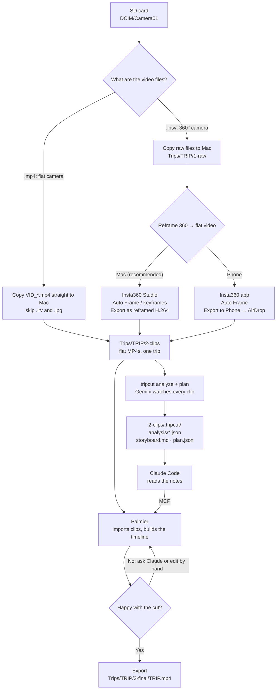

# Insta360 → finished video (tripcut + Palmier)

tripcut watches your clips with Gemini and writes down what's in them.
Claude Code reads those notes and builds the edit in Palmier.
You review, tweak, and export.

> Do Step 0 once before your first trip.

## The whole flow



> The diagram renders on GitHub. In VS Code, install the
> *Markdown Preview Mermaid Support* extension, then open the preview (⇧⌘V).

## Folder layout (one folder per trip)

```
~/Movies/Trips/
└── 2026-09-Bali/
    ├── 1-raw/          ← original .insv files from the camera (your backup; tripcut ignores this)
    ├── 2-clips/        ← reframed MP4s from Insta360. Point tripcut at THIS folder
    │   └── .tripcut/   ← created by tripcut: analysis, storyboard, plan (hidden; ⌘⇧. in Finder)
    └── 3-final/        ← the finished video from Palmier
```

---

## Step 0 · One-time setup

**tripcut** (Terminal):

```bash
conda create -n tripcut python=3.12 -y
conda activate tripcut
conda install -c conda-forge ffmpeg -y
pip install -e ~/Projects/tripcut
```

**Gemini key:** get a free one at <https://aistudio.google.com/apikey>, then add this line to `~/.zshrc`:

```bash
export GEMINI_API_KEY=your-key-here
```

**Palmier:**
1. Download [PalmierPro.dmg](https://github.com/palmier-io/palmier-pro/releases/latest/download/PalmierPro.dmg) and drag it to Applications. The free tier is enough, and no account is needed.
2. Connect it to Claude Code (once, from any folder):
   ```bash
   claude mcp add --scope user --transport http palmier-pro http://127.0.0.1:19789/mcp
   ```

## Step 1 · Get the clips onto your Mac

Insert the SD card. The videos are in **`/Volumes/SD Card/DCIM/Camera01/`**.

> Importing in Insta360 Studio does **not** copy your videos to the Mac. It only adds them to
> Studio's library (thumbnails and edit settings in `~/Documents/Insta360/Studio/`). The footage
> stays on the card until you copy or export it.

Check the file types in `Camera01`:

### Flat camera: the videos are `.mp4`

There's nothing to reframe. Copy the originals into `2-clips`:

```bash
mkdir -p ~/Movies/Trips/2026-09-Utah/2-clips
cp -p "/Volumes/SD Card/DCIM/Camera01/"VID_202609*.mp4 ~/Movies/Trips/2026-09-Utah/2-clips/
```

Change `202609` to the dates of the trip you want (`VID_YYYYMMDD_…`). `-p` keeps the original
recording times, which tripcut uses to order the trip. Dragging the files in Finder works too.
Skip `.lrv` files (low-res previews) and `.jpg` photos.

Then go to Step 2.

### 360° camera: the videos are `.insv`

Copy the `.insv` files into `1-raw`, then reframe them with Option A or B below.

Button names change between camera models and app versions. If one doesn't match, look for the closest equivalent.

### Option A: Insta360 Studio on the Mac (recommended)

Files land straight in the right folder, and you choose the codec.

1. Open **Insta360 Studio** and open the clips from `1-raw`.
2. For each clip, choose how to point the "camera":
   - **Auto Frame / AI Reframe**: Insta360 picks the angles for you (fastest).
   - **Deep Track**: follow a person or subject.
   - **Keyframes**: aim it yourself at chosen moments.
3. Set the aspect ratio: **16:9** for YouTube, or **9:16** for Reels/Shorts. Use the same one for the whole trip.
4. Click **Export** and choose the **reframed (flat)** video, not 360. Use these settings:
   - Encoding: **H.264** (most compatible)
   - Resolution: **1080p** (or 4K if you want it)
   - Output folder: **`2-clips`**
5. Leave stabilization (FlowState) **on**.

### Option B: Insta360 app on your phone

1. **Album** → open a clip → tap **Auto Frame** (or drag to aim and add keyframes). Choose **16:9** or **9:16**.
2. Tap the **Export** button (top right) → **Save settings** (resolution, bitrate) → **Export to Phone**.
   - To export several clips at once, tap the **check icon** at the top right of the Album page, select the clips, then tap **Export to Phone**. The defaults are 1080p, 30 fps, 25 Mbps.
3. AirDrop the videos to your Mac and move them into `2-clips`.

> Phone exports and AirDrop can change file names and dates, and tripcut uses those to
> put the trip in order. If clips come out of order, use Option A, or tell Claude the right order.

### Don'ts
- Don't put `.insv` files in `2-clips`. tripcut skips them.
- Don't export the unreframed 360° view (a 2:1 "panorama" video). tripcut skips those too.
- Don't mix trips in one `2-clips` folder.

## Step 2 · Let tripcut watch the clips

```bash
conda activate tripcut
tripcut analyze ~/Movies/Trips/2026-09-Bali/2-clips          # Gemini watches each clip (cached: only runs once per clip)
tripcut plan    ~/Movies/Trips/2026-09-Bali/2-clips -d 60    # suggested cut of up to 60 s; add -a 9:16 for vertical
```

**Mac short on space? Leave the clips on the camera or SD card.** Give tripcut a folder on the Mac for its
notes (a few hundred MB) and point `--source` at the drives. `--from`/`--to` pick the trip when a drive holds
several. tripcut remembers all three, so later commands only need the trip folder:

```bash
tripcut analyze ~/Projects/insta360_Videos/Europe_2026 \
  -S "/Volumes/Internal/DCIM/Camera01" -S "/Volumes/SD Card/DCIM/Camera01" \
  --from 2026-06-30 --to 2026-07-10
tripcut plan ~/Projects/insta360_Videos/Europe_2026 -d 90
```

Palmier also links to the clips where they are rather than copying them. Keep the drives plugged in until the
final export (keep the camera charging), and don't format them until the finished videos are backed up.

**How long?** `-d` is a maximum, not a quota: the planner stops early rather than repeat a look.
Pick it by where the video goes:

| Where | Length | Aspect |
|---|---|---|
| Instagram Reel / TikTok / Shorts | 30–45 s | `-a 9:16` |
| Sharing with friends and family, YouTube | 60–90 s | 16:9 (default) |
| A longer memory film for yourself | 2–4 min | 16:9; also uses score-6 shots and your talking parts |

A rough check: count the distinct shots scoring 7+ and allow about 3 s each.
The Utah trip has about 20–25 distinct strong shots, so about 60–75 s.

This creates, inside `2-clips/.tripcut/`:

| File | What's in it |
|---|---|
| `analysis/*.json` | Per clip: summary, place, time of day, people, readable signs, what's said, problems with time ranges. Per shot: in/out seconds, best instant (`peak`), score, shot size, camera motion, framing (upright / tilted / sideways), stability, exposure, energy, and what to do with the sound |
| `clips.json` | Each clip's recording time, length, resolution and orientation (width × height) |
| `storyboard.md` | The suggested cut as a readable shot list. Open it to see what Gemini picked |
| `plan.json` | The same cut, in a form Claude can use directly |

## Step 3 · Build the edit in Palmier with Claude

1. **Open Palmier** and leave it open. Claude talks to it on your Mac.
2. Open Claude Code in the trip folder (`cd ~/Movies/Trips/2026-09-Bali && claude`, or open that folder in VS Code).
3. Paste a prompt like this:

> Read tripcut's notes in `2-clips/.tripcut/` (storyboard.md, plan.json, clips.json and analysis/).
> In Palmier, create a project called "Bali 2026", import every clip from `2-clips`, and build a
> cut of **up to 60 seconds, 16:9** in recording order, using the storyboard as the starting point.
> - Use only strong shots (score 7+; a 6 only when a place has nothing better). Many shots look
>   alike (same cliffs, same river), so use only the best of each look-alike group anywhere in the
>   video. If that leaves less than the target length, make it shorter rather than repeat.
> - Cut each shot from its `start`/`end`; when trimming shorter, keep its `peak`.
> - Keep my talking parts as complete sentences (use Palmier's transcript to cut on word boundaries).
> - Rotate shots marked `sideways` or `upside_down`, straighten `tilted` ones, and brighten `dark` or `backlit` ones.
> - Check orientation in clips.json: vertical clips go on a blurred background, or leave them out.
> - Keep my voice only on `audio: speech` shots. Mute `chatter` (my fumbling), `music` and
>   `noisy`, and let the music carry those shots. Keep `ambient` sound low under the music.
> - Vary shot size and motion, don't put the same subject twice in a row, and follow the `energy` of each shot when pacing.
> - Add a short caption when the location changes (use `location_guess` and `visible_text`).
>
> Make it look professional and feel like a fun trip, but natural, never try-hard: no letterbox bars,
> no animated or kinetic text, no speed ramps or showy slow motion, no animated maps, no dramatic
> "epic" music, no effects. Speed up only to rescue footage (e.g. a long drive as a few quick seconds).
>
> Also:
> - Open on a hook (an 8+ shot in the first 3 seconds) and end on a strong wide shot with the title.
> - Mix `tone`s: put `fun` and `warm` moments with people between the `scenic` shots.
> - Light, fun, royalty-free music (indie or acoustic feel, not epic), changing gently between places.
>   Detect its beats and cut on them; b-roll 2–4 s.
> - Clean hard cuts and match cuts. Use an in-camera `transition` (prefer a `reveal`) at most twice
>   in the whole video, and only where it's clearly good. No software transitions at all: no zooms,
>   spins, glitches or wipes. At most a short dip to black at the end.
> - Match motion direction across cuts, and let natural sound lead slightly into the next shot.
> - Natural colour, the same across clips so nothing jumps (no heavy teal-orange look); fix `bright`/`dark` shots first.
> - Text: one simple title and a few plain place names, in the same clean font.

4. Watch the result in Palmier. Ask for changes ("swap the second beach shot for the sunset", "make it 60 seconds"), or drag things on the timeline yourself.

## Step 4 · Export the final video

Ask Claude:

> Export the timeline as a ProRes master, then run `tripcut finish` on it into `3-final/bali-2026.mp4`.

Palmier's own H.264/H.265 export works too, but its bitrate is fixed and fairly low (about 20–25 Mbps at 4K,
against the Insta360's ~50). `tripcut finish` turns the near-lossless ProRes master into the final file:

- **Picture:** 10-bit H.265 like the camera's. On a Mac, Apple's hardware encoder does 4K in about a minute.
- **Sound:** mastered to −14 LUFS, the level YouTube and Instagram play at, with peaks kept below clipping.

```bash
tripcut finish master.mov -o 3-final/bali-2026.mp4 --delete-masters
```

**Short on disk?** A 4K ProRes master is about 4 GB per minute, and `tripcut finish` needs room for working
files too (about 2.5× the finished file). It checks before starting and stops with a clear message if there
isn't enough. Put the master and the working files on a bigger drive (exFAT or APFS; a FAT32 drive can't
hold files over 4 GB):

```bash
tripcut finish "/Volumes/SD Card/master.mov" -o 3-final/bali-2026.mp4 \
  --tmp-dir "/Volumes/SD Card" --delete-masters
```

A film exported in parts (two copies of the timeline, cut at a hard cut) can be given as several masters;
`--wait` waits for each to finish exporting. The parts are joined without re-encoding, and the sound is joined
to the exact sample, so there's no click or level jump at the join. Masters are deleted only once the final
file is safely written.

**Keep a copy** of the finished videos somewhere other than YouTube (Google Drive, iCloud). YouTube's copy is
re-compressed, and once the raw clips are deleted, Palmier can't export again.

---

## If something goes wrong

| Problem | Fix |
|---|---|
| Clips are in the wrong order | Keep Insta360's original file names (`VID_2026…`), or tell Claude the right order |
| tripcut says it skipped files | They're raw `.insv` or unreframed 360° videos. Re-export them as reframed (Step 1) |
| Gemini errors / "429" | You hit the free tier's rate limit. Run `tripcut analyze` again: finished clips are cached and skipped |
| Claude says the Palmier tools aren't available | Open Palmier, then start a **new** Claude Code session |
| Claude stops partway ("usage limit") | That's Claude Pro's limit. Do one day of the trip per session, then join them at the end |
| Talking gets cut mid-word | Ask Claude to recut that part using Palmier's transcript |
